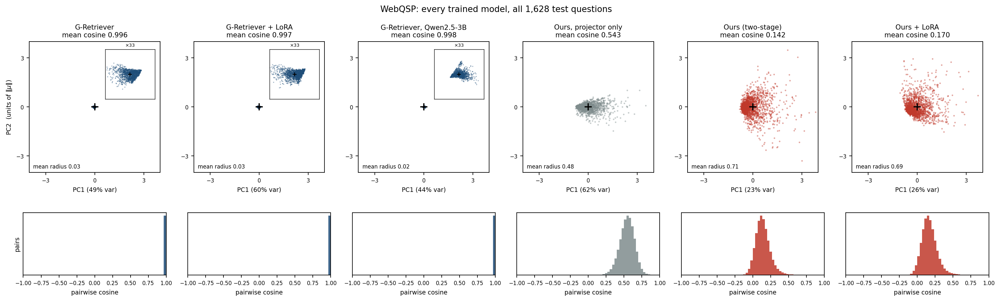
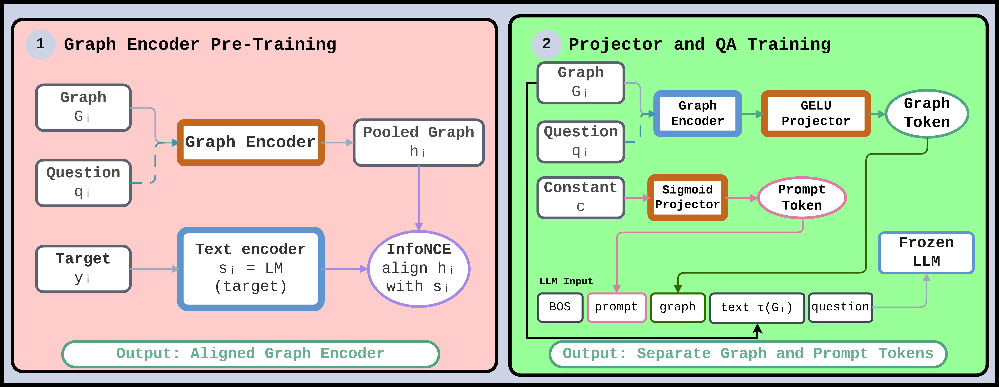

# On the Token Collapse Phenomenon in Textual Graph Soft Prompting

This is the public code release for **On the Token Collapse Phenomenon in
Textual Graph Soft Prompting**. It provides the training pipelines, graph-free
controls, token-geometry diagnostics, and fixed-weight interventions used to
study token collapse in the paper.

The repository is intended primarily to reproduce the paper's experiments.
It also provides extension points for researchers developing new graph
encoders, projectors, and training objectives to address graph–LLM alignment
problems, using the same diagnostics to evaluate their methods.

[**Paper (preprint)**](https://arxiv.org/abs/2610.31572)

The paper is a preprint. Everyone is welcome to
[report an issue](https://github.com/difra100/Token_Collapse_KGQA/issues),
including bugs, reproduction difficulties, unclear instructions, or questions
about the reported results. When reporting a technical problem, please include
the command you ran, your environment, and the relevant error or log output.

**Getting started:** [Setup](#quick-start) ·
[Training](#train-a-graph-soft-prompt-model) ·
[Diagnostics](#audit-graph-token-geometry) ·
[Customization](docs/CUSTOMIZATION.md)

The repository has two practical goals:

1. reproduce the paper's graph soft-prompt training and intervention analyses;
2. support new methods for preserving graph-specific information and evaluating
   whether the LLM uses it.

The default implementation is based on the included G-Retriever source tree.
It supports its graph transformer (`gt`), GCN (`gcn`), and GAT (`gat`) encoders.
The public launcher also provides decoder-width-aware projectors for Llama- and
Qwen-style Hugging Face causal LMs.

## The problem: graph tokens can collapse

Does a graph-derived token actually carry information that the LLM uses? When
the same graph also appears as text in the prompt, answer accuracy alone cannot
tell us. Across the G-Retriever configurations studied in the paper, projected
graph tokens have mean pairwise cosine **0.985–0.998**, even though the pooled
encoder representations remain more distinct.

[](figures/token_space_appendix_webqsp_all_models.png)

*All 1,628 WebQSP test questions. Top: mean-centred token projections onto two
principal components, in units of the mean-token norm; collapsed models include
33× zoomed insets. Bottom: pairwise cosine distributions. Click the figure to
view it at full resolution.*

Under the standard Llama-2 setup, replacing G-Retriever's token with the training
mean, another example's token, or a token recomputed from another graph changes
the score by less than two percentage points on each benchmark. A learned
graph-independent prompt matches or exceeds its score on all three datasets.
Collapse describes the dominance of a shared direction; it does not establish
that the remaining input-specific residual is invisible to the LLM. We use
**fixed-weight interventions** to test whether that variation affects answers.

## Our approach: separate graph representation from prompting

[](figures/two_stage_pipeline.png)

1. **Pretrain the graph encoder.** Condition the encoder on the question and
   align its pooled representation to a frozen text embedding with InfoNCE.
   Targets are answers, or verbalised graphs when the answer space is too small
   to distinguish samples. This stage does not load the answer LLM.
2. **Freeze the encoder and train two pathways.** A GELU projector produces an
   input-dependent graph token, while a separate graph-independent pathway
   learns a shared prompt token. Both precede the verbalised graph and question
   in the frozen LLM's input; the projectors are trained with the answer loss.

*Orange modules are trained; blue modules are frozen. See
[two-stage training](#optional-two-stage-training) for launch commands.*

## Selected results

The following values are from **Table 4 of the paper**, using the standard
two-stage recipe. Scores are accuracy (%) on ExplaGraphs and SceneGraphs and
Hit@1 (%) on WebQSP. Cosine is measured on the graph token, excluding the
separate shared prompt token.

| Dataset | Answer LLM | G-Retriever score | Ours score | G-Retriever cosine | Ours cosine | Ours ΔGSWAP (pp) |
| --- | --- | ---: | ---: | ---: | ---: | ---: |
| WebQSP | Llama-2-7B | 70.33 | 69.90 | 0.996 | 0.142 | −1.97 |
| SceneGraphs | Llama-2-7B | 81.35 | 72.50 | 0.993 | 0.133 | −5.30 |
| ExplaGraphs | Llama-2-7B | 85.56 | 85.74 | 0.997 | 0.099 | −1.44 |
| WebQSP | Qwen2.5-3B | 57.13 | 65.79 | 0.997 | 0.200 | −2.09 |
| SceneGraphs | Qwen2.5-3B | 76.05 | 72.65 | 0.997 | 0.139 | −6.50 |
| ExplaGraphs | Qwen2.5-3B | 74.37 | 83.94 | 0.998 | 0.103 | +0.36 |

**GSWAP** replaces the graph used to compute the token while preserving the
original question conditioning and verbalised graph. Differences are relative
to the same model's unmodified score; negative values indicate a drop. The
paper treats an answer-level effect as resolved only when **|Δ| > 2 percentage
points and exact McNemar p < .05**. The Qwen rows use matched training budgets;
the token-space figure also includes checkpoints from separate robustness and
ablation experiments.

The two-stage pipeline reduces collapse across these settings, but stronger
token variation does not guarantee graph use or higher task scores. For example,
SceneGraphs shows graph-replacement effects alongside lower accuracy, while
ExplaGraphs retains accuracy without a resolved graph-replacement effect.
The repository therefore supports both training and
[auditing the resulting graph tokens](#audit-graph-token-geometry).

## Quick start

Clone the public repository and enter its directory:

```bash
git clone https://github.com/difra100/Token_Collapse_KGQA.git
cd Token_Collapse_KGQA
```

With [uv](https://docs.astral.sh/uv/), run:

```bash
uv sync --python 3.10
uv run python run_train.py --help
```

This creates `.venv` and installs PyTorch 2.0.1 with CUDA 11.8 and matching
PyTorch Geometric wheels. It requires a compatible NVIDIA driver. The uv
configuration supports Python 3.10 and 3.11; Python 3.10 or newer is required by
the runtime type annotations in the public launchers' dependencies. Prefix the
Python commands below with `uv run` to use this environment.

For the original Conda/pip setup:

The code was developed with Python 3.9, PyTorch 2.0.1, CUDA 11.8, and a recent
NVIDIA GPU. Install a PyTorch build that matches your CUDA driver first, then:

```bash
conda create -n graph-prompts python=3.9 -y
conda activate graph-prompts
conda install pytorch==2.0.1 torchvision==0.15.2 torchaudio==2.0.2 pytorch-cuda=11.8 -c pytorch -c nvidia

pip install pyg_lib torch_scatter torch_sparse torch_cluster torch_spline_conv \
  -f https://data.pyg.org/whl/torch-2.0.1+cu118.html
pip install -r requirements.txt
```

LLM weights are not included. Set `GRAPH_PROMPT_LLM_PATH` to either a local
model directory or a Hugging Face identifier for a model you are authorized to
use.

```bash
export GRAPH_PROMPT_LLM_PATH=meta-llama/Llama-2-7b-hf
export WANDB_MODE=offline  # optional: keep experiment tracking local
```

## Prepare data

The repository includes the raw ExplaGraphs TSV, SceneGraphs questions CSV,
and compressed GQA scene graphs from the included
[G-Retriever upstream revision](https://github.com/XiaoxinHe/G-Retriever/tree/315b0ff8a206536067602fb97e77c10f4d646d5d/dataset).
These total approximately 55 MB. Extract the scene graphs first (`unzip`
required); the extracted JSON files are ignored by Git:

```bash
cd G-Retriever-upstream
unzip -n dataset/gqa/sceneGraphs.zip -d dataset/gqa

test -s dataset/expla_graphs/train_dev.tsv
test -s dataset/scene_graphs/questions.csv
test -s dataset/gqa/train_sceneGraphs.json
cd ..
```

Then run only the benchmarks you need. These commands create graph embeddings,
split files, and (for SceneGraphs and WebQSP) PCST retrieval caches. The second
ExplaGraphs command validates the prepared dataset. Encoding also downloads
`sentence-transformers/all-roberta-large-v1` from Hugging Face unless cached.
WebQSP preprocessing downloads `rmanluo/RoG-webqsp` automatically. Generated
embeddings, retrieval caches, model weights, and predictions are ignored by Git.

```bash
cd G-Retriever-upstream

# ExplaGraphs: requires the downloaded train_dev.tsv.
python -m src.dataset.preprocess.expla_graphs
python -m src.dataset.expla_graphs

# SceneGraphs: requires questions.csv and gqa/train_sceneGraphs.json.
python -m src.dataset.preprocess.scene_graphs
python -m src.dataset.scene_graphs

# WebQSP preprocessing downloads RoG-WebQSP through Hugging Face.
python -m src.dataset.preprocess.webqsp
python -m src.dataset.webqsp
cd ..
```

See [data/README.md](data/README.md) for the data contract. Preprocessing may
download large resources and can take substantial disk space.
Keep the upstream raw files and their row order unchanged to preserve sample
IDs and generated train/validation/test splits.

## Train a graph soft-prompt model

Run all commands from the repository root. The standard end-to-end setup trains
the selected GNN and projector while keeping the LLM frozen:

```bash
CUDA_VISIBLE_DEVICES=0 python run_train.py \
  --dataset webqsp \
  --model_name flex_graph_llm \
  --gnn_model_name gt \
  --llm_model_name 7b \
  --llm_frozen True \
  --output_dir outputs/webqsp_llama_gt
```

Use `--gnn_model_name gcn` or `gat` to select the included alternatives. To
adapt the decoder with the included LoRA setting, use `--llm_frozen False`:

```bash
CUDA_VISIBLE_DEVICES=0 GRAPH_PROMPT_LLM_PATH=Qwen/Qwen2.5-3B \
python run_train.py --dataset webqsp --model_name flex_gelu_graph_llm \
  --gnn_model_name gt --llm_model_name qwen25 --llm_frozen False \
  --output_dir outputs/webqsp_qwen_gt
```

LLM loading detects the visible GPUs and their available memory automatically.
Use `CUDA_VISIBLE_DEVICES=0` to select one GPU. To set an explicit model-loading
budget, add `--max_memory 20` for one GPU or `--max_memory 20,20` for two GPUs
(values are in GiB). Budgets follow visible GPU order; extra entries are ignored.
Leave room for the graph encoder, activations, and optimizer during training.
LLM autocast uses bfloat16 on GPUs that support it and float16 on older GPUs.

`flex_graph_llm` uses the original sigmoid projector. `flex_gelu_graph_llm`
uses GELU. Both infer their output width from the loaded LLM, so the projector
matches the decoder embedding space instead of assuming a fixed hidden size.

Training logs epoch losses through Weights & Biases and writes checkpoints and
predictions under the requested `--output_dir`. Use `WANDB_MODE=offline` or
configure your preferred tracking backend before launch.

## Optional two-stage training

The two-stage variant first contrastively pretrains a graph encoder without
loading an LLM, then freezes it while learning the graph-token and prompt-token
pathways. Stage 1 produces a checkpoint in `stage0/`:

```bash
CUDA_VISIBLE_DEVICES=0 ALIGN_TARGET=answer python run_stage1.py \
  --dataset webqsp --gnn_model_name gt --seed 0 --num_epochs 30
```

Use its checkpoint for stage 2:

```bash
CUDA_VISIBLE_DEVICES=0 \
GRAPH_PROMPT_LLM_PATH=meta-llama/Llama-2-7b-hf \
ALIGN_PROJ=gelu \
ALIGN_CKPT="$PWD/stage0/webqsp_gt_seed0_answer.pt" \
python run_train.py --dataset webqsp --model_name alignjoint_llm \
  --gnn_model_name align_gelu --llm_model_name 7b \
  --output_dir outputs/webqsp_twostage
```

## Audit graph-token geometry

The diagnostic workflow records the graph tokens actually injected into the
decoder, then evaluates fixed-weight token and graph interventions in isolated
processes. After training a checkpoint, run:

```bash
CUDA_VISIBLE_DEVICES=0 python run_probe.py \
  --dataset webqsp --model-name flex_graph_llm --gnn gt \
  --ckpt-dir "$PWD/outputs/webqsp_llama_gt" \
  --conditions "real mean_token shuffle_token graph_swap rand_nodes_real rand_edges"
```

The probe saves one prediction record per condition and reports inter-example
cosine, residual ratio, effective rank, token norms, and intervention scores.
For multi-token methods, compare both pooled inter-example geometry and
within-example token cosine.

## Bring your own components

We welcome extensions that explore how to improve graph–LLM alignment. You can
replace the graph encoder or projector, adapt the training objective, or use a
different answer LLM. The paper's geometry measurements and interventions offer
a common evaluation protocol: assess token variation, graph-specific use, and
task performance together.

The public extension points are deliberately small:

- **LLM:** set `GRAPH_PROMPT_LLM_PATH`; `flex_graph_llm` reads the decoder input
  embedding width at runtime.
- **Graph encoder:** register a class in
  `G-Retriever-upstream/src/model/gnn.py:load_gnn_model`. It must return
  `(node_embeddings, edge_attributes)` like the included GCN/GAT/GT classes.
- **Projector:** subclass `FlexibleGraphLLM` in
  [public_models.py](public_models.py) and override
  `build_projector(input_dim, output_dim)`.
- **Dataset:** add an adapter under `G-Retriever-upstream/src/dataset/` that
  returns graph, question, description, label, and id fields compatible with
  the upstream collator.

[docs/CUSTOMIZATION.md](docs/CUSTOMIZATION.md) gives the exact extension
contracts and small code examples.

## Repository layout

```text
run_train.py          Portable end-to-end training launcher
run_stage1.py         Optional LLM-free contrastive encoder pretraining
run_probe.py          Fixed-weight token and graph diagnostic launcher
public_models.py      Decoder-width-aware projector registrations
controls.py           Graph-free and two-stage model variants
G-Retriever-upstream/ Included upstream training/data implementation
data/                 Local raw data and caches (ignored)
checkpoints/          Local model weights (ignored)
outputs/              Local checkpoints, predictions, and metrics (ignored)
```

## Licensing

The included upstream G-Retriever code retains its own license in
`G-Retriever-upstream/LICENSE`. Datasets and model weights remain subject to
their respective terms.
